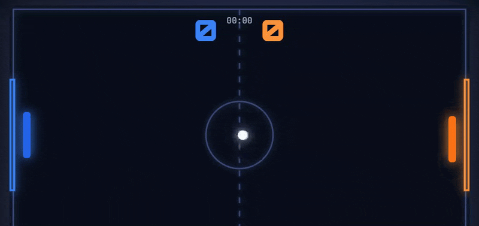

# RLPong

Pong, if Pong had a boost meter and a grudge.



<sub>Blue is a fifteen-line tracking bot I wrote to film this. Orange is the game's own Hard AI. Blue won the point.</sub>

Two paddles, one ball, a Rocket League arena. Hit the boost and your paddle lunges forward for a power shot. Every hit adds speed, and past 720 px/s it goes supersonic: it turns cyan, glows twice as hard and makes a noise about it. Goals explode. The screen shakes. First to seven.

TypeScript and a canvas. No game engine, no dependencies at runtime.

## Play

```sh
npm install
npm run dev
```

Open http://localhost:5173 and pick a fight.

|            | Move      | Boost                   |
| ---------- | --------- | ----------------------- |
| **Blue**   | `W` `S`   | `Space` or `Left Shift` |
| **Orange** | `↑` `↓`   | `Right Shift`           |

`Enter` starts or rematches. `Esc` pauses. The game also pauses itself if you tab away mid-rally.

**vs AI** comes in three tempers. Easy reacts in 0.28 s and never boosts. Normal reacts in 0.18 s and boosts. Hard reacts in 0.1 s, boosts, and aims up to 78 px off, which leaves just enough room to beat it with a well-placed shot.

**Local 2-player** puts both of you on one keyboard. Settle it properly.

## How it's built

The game logic doesn't know the canvas exists. Physics, the paddles, the AI and the match state are plain TypeScript, unit tested, and run on a fixed timestep so a rally plays out the same on any monitor. Rendering, sound and menus sit on top as thin glue.

```
src/
  config.ts     every tunable number: speeds, boost, AI tempers
  core/         maths, input, the fixed-timestep loop, the match state machine
  entities/     Ball, Paddle (with the boost dash), Ai
  systems/      physics, particles, sound synthesised with Web Audio
  render/       theme, canvas renderer, HUD
  ui/           menus and overlays
```

Want a faster game? It's all in [`src/config.ts`](src/config.ts).

```sh
npm test         # Vitest
npm run build    # typecheck and production build
```

When your system asks for reduced motion, the screen stops shaking, the ball loses its trail and particle bursts drop to a fifth.
